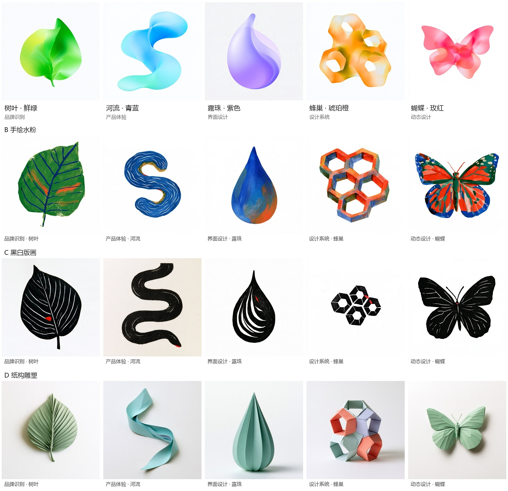

# explore

视觉蒸馏与原创生成工作流

## 目标

从链接或图片中分别提取材质、纹理、色彩、光影、叙事、构图和镜头规律，以新的内容组织画面，并通过可核对的视觉标准持续修正。

## 当前阶段

已形成工作流 v0.1，通用方法见 [方法笔记](docs/METHOD_NOTES.md)。已完成一次 Midjourney 参考输入、候选生成、局部编辑与文件归档实验，完整交付验收仍待验证。

当前项目：[设计的生境 · 自然元素视觉系统](projects/2026-11-12-nature-symbols/README.md)。A 光谱渐变为当前主方向，树叶、河流、露珠、蜂巢、蝴蝶分别采用鲜绿、青蓝、紫色、琥珀橙、玫红主色；同时保留 B 手绘水粉、C 黑白版画、D 纸构雕塑三个可选方向。图像已通过视觉方向审核，发布规格验收待完成。

项目归档：[羽毛笔与静水](projects/2026-11-06-feather-river/README.md)。

## 已明确的工作要求

- 为每份参考指定取用维度，并对照原图验证。
- 参考构图时提取空间关系、尺度、视线引导、景别与机位。
- 独立设计新画面的素材、元素和内容关系。
- 材质、故事、构图可以分别取自不同参考；具体分工由每次创作简报确定。
- 将视觉感转译为可见、可核对的画面特征。
- 生成后对照参考与简报验收，记录偏差，再进行针对性修改。

## 文档入口

1. [方法笔记](docs/METHOD_NOTES.md)
2. [创作方向](docs/DIRECTION.md)
3. [执行工作流](WORKFLOW.md)
4. [单次项目模板](templates/PROJECT.md)

从项目模板开始填写任务；按工作流逐阶段执行。每个项目使用独立目录 `projects/YYYY-MM-DD-name/`，记录输入角色、当前母版、提示词、输出和验收。

## 版本管理

本目录使用独立本地 Git 仓库，按已完成阶段提交。公开文档保留通用方法；账号密码及受限资料独立管理。
