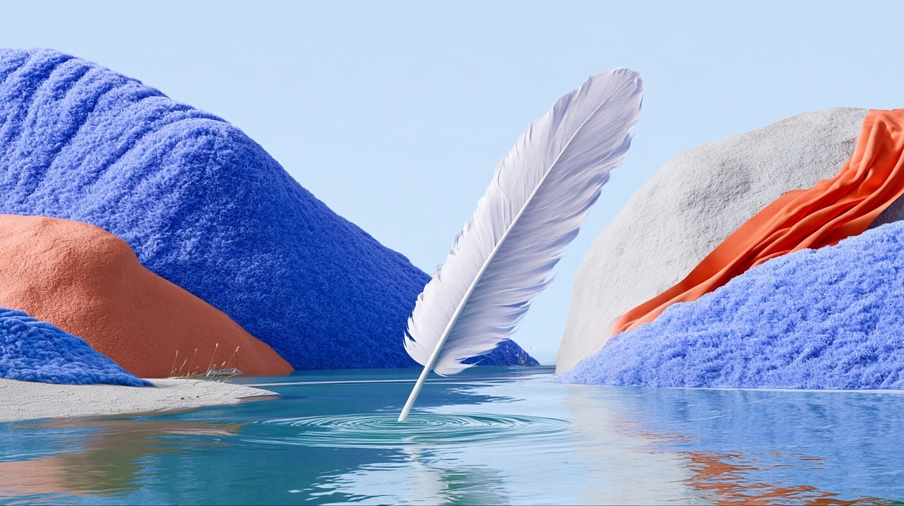

# 羽毛笔与静水

状态：当前选定图待用户确认。

象牙色羽毛笔触及青蓝色静水，局部环形涟漪形成事件中心。背景为蓝色绒面地貌、白色山体与珊瑚色折叠区域；空间、材质和光色共同建立超现实自然场景。

## 文件

- [当前选定图](images/selected.jpg)：1456 × 816 px，MJ 原生 JPEG。
- 同轮候选：[1](images/candidate-1.jpg)、[2](images/candidate-2.jpg)、[3](images/candidate-3.jpg)。
- [本次局部编辑输入](inputs/edit-base.jpg)。
- [实际提示词与参数](PROMPT.md)。

## 参考分工

[视觉参考项目](https://www.behance.net/gallery/175312693/Microsoft-Teams-Backgrounds)承担材质、色彩和柔光参考：宽幅曲面、厚薄边缘、短绒触感和冷暖材质块面。原始参考图独立管理。

新画面的主体为羽毛笔，事件为笔尖触水形成涟漪。构图采用中央斜向羽毛、两侧地貌围合、前景水面与远景留白。

## 当前验收

| 检查项 | 当前结果 |
| --- | --- |
| 主体 | 羽毛完整入镜，笔尖下端接触水面 |
| 材质 | 绒面地貌、折叠表面与水体可辨 |
| 光色 | 浅蓝、蓝紫、象牙白与珊瑚色形成主体色块 |
| 水面 | 平缓倒影，接触点有风格化环形涟漪 |
| 造型细节 | 笔尖为简化形态，金属笔尖识别度仍可提升 |
| 构图 | 以开阔水面为主，主体与接触点可辨 |
| 交付 | 图像和记录已归档；当前选定图待用户确认 |

本项目已执行参考输入、MJ 生成、局部编辑、候选筛选与本地归档。工作流中的独立构图草稿、主体设定及面向具体投放用途的包装验收仍待验证。
