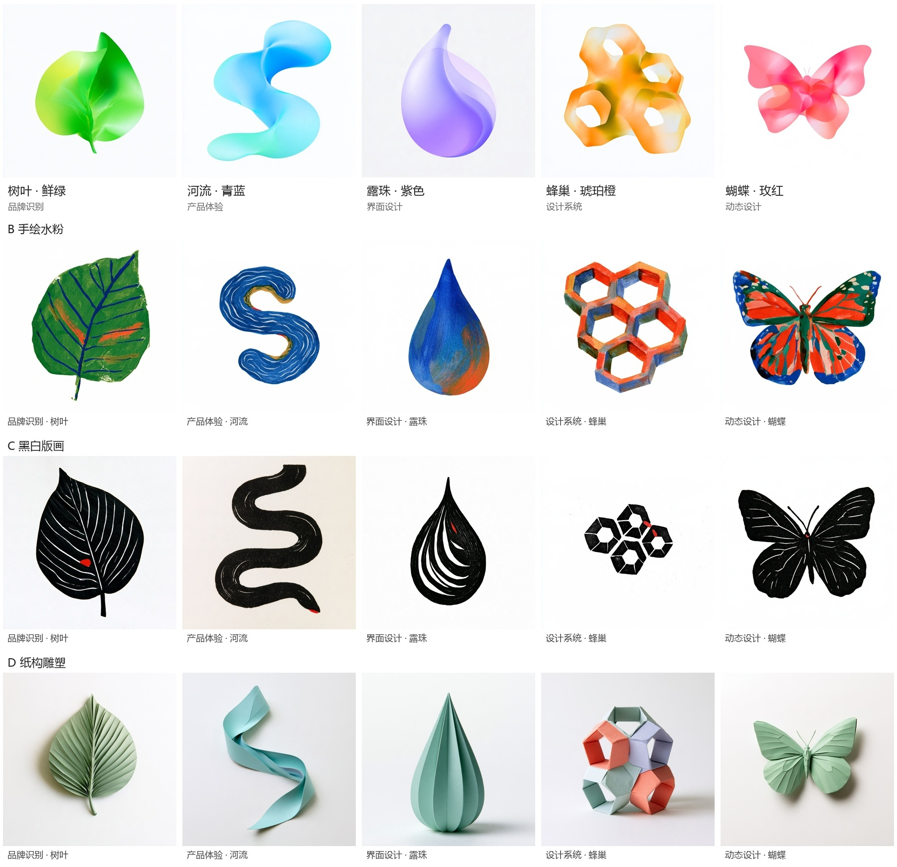

# 设计的生境 · 自然元素视觉系统

当前主方向：A 光谱渐变。五个自然元素分别代表产品体验与品牌视觉设计中的五个领域，每个元素拥有独立主色。

## 元素与主色

| 元素 | 代表领域 | 对应关系 | A 组主色 |
| --- | --- | --- | --- |
| 树叶 | 品牌识别 | 叶形与叶脉共同构成稳定身份 | 鲜绿 |
| 河流 | 产品体验 | 连续路径连接入口、转折与出口 | 青蓝 |
| 露珠 | 界面设计 | 透明接触层呈现并改变观看信息的方式 | 紫色 |
| 蜂巢 | 设计系统 | 共享规则和连接方式构成可扩展整体 | 琥珀橙 |
| 蝴蝶 | 动态设计 | 展开、开合与飞行表达状态和变化 | 玫红 |

A 组在相邻色域内组织柔和渐变，保留通透叠色和主要轮廓。其余可选方向为 B 手绘水粉、C 黑白版画、D 纸构雕塑，分别强调笔触、黑白雕刻线与纸张折面。

## 当前交付

- [A 组预览](previews/A-gradient.jpg)及[配色对照](previews/A-before-after.jpg)。
- [B 组预览](previews/B-gouache.jpg)、[C 组预览](previews/C-woodcut.jpg)、[D 组预览](previews/D-paper.jpg)。
- `images/`：四组共 20 张独立图像，均为 MJ 原生 1024 × 1024 JPEG。
- [提示词与任务索引](PROMPTS.md)。
- [文件清单与尺寸](assets.json)。

## 参考与审核

A 组借鉴 [Graphic Story](https://www.behance.net/gallery/207279797/-Graphic-Story) 的柔焦渐变、半透明叠色与简洁符号轮廓；主体、领域映射及独立主色按本项目组织。

已逐张检查选定图，并核对整组预览：主体完整、轮廓可辨、四组画风差异明确；A 组五种主色可目视区分。当前通过视觉方向审核，发布规格验收待完成。

背景以白色或近白留白为主，部分保留纸纹或轻微灰阶。严格纯白背景与正式投放规格需在使用前核对。
