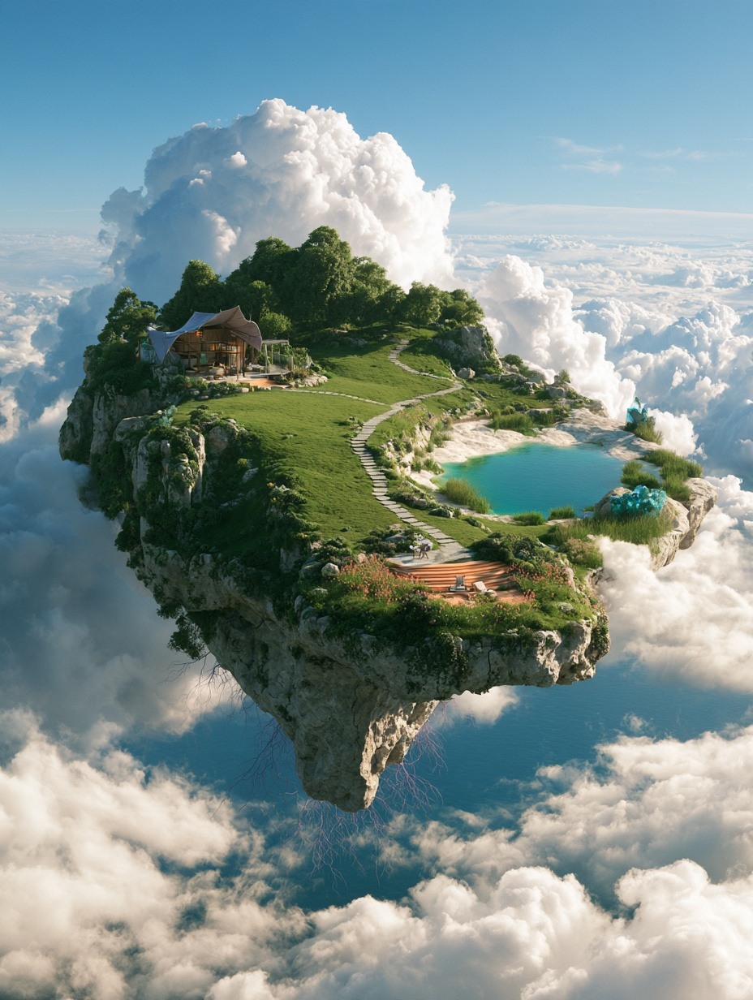

# 浮空个人家园

当前概念稿以宽敞浮空岛承载居所、创作空间、庭院、开放草地、水岸与观景台，步道连接各区。自然元素融入建筑、铺装、水体、矿石与植被。

Midjourney 任务 bc4a65c5-2ec1-4cc9-a5b0-ee8ce3cfd88b，第 4 张，原尺寸 928×1232。此图为家园尺度与环境关系的概念参考，待用户确认。人物设定与后续场景细化尚待确定。

后续使用 [五组自然元素素材](../2026-11-12-nature-symbols/catalog.html) 与其材质说明作为优化依据。生成提示词见 PROMPT.txt。
